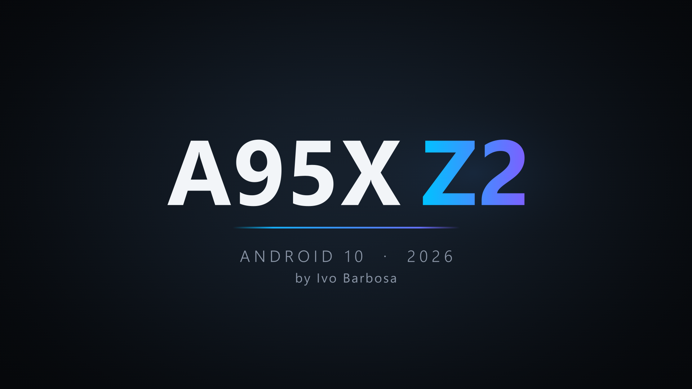

# A95X Z2 — Clean Android 10 Firmware

A clean, fast and stable **Android 10** firmware for the **A95X Z2** TV box
(Rockchip **RK3318**, 2 GB RAM, board `A95XF2R_V20`), which shipped with Android 9.
It is based on the HK1 Max Android 10 firmware (same SoC) and adapted to this board,
with a custom lightweight launcher, root, a working front display and no bloatware.

> ⚠️ **Use at your own risk.** Flashing firmware can make your device unbootable.
> The authors are **not responsible for any damage**. Read **[DISCLAIMER.md](DISCLAIMER.md)** first.

## Features

- **Android 10** (kernel 4.19) on the original A95X Z2 hardware: HDMI, Wi-Fi, IR remote,
  USB, Ethernet and the **front VFD clock** working.
- **No bloatware**: outdated and unwanted preinstalled apps are physically removed from
  the image (not just hidden), giving ~650 MB of extra free space.
- **A95X Z2 Home**: a custom launcher (~160 KB, no ads, no internet permission,
  ~38 MB RAM) with favorites, categories, recents, sorting, hide apps, RAM/temperature
  indicators, screensaver, config export/import and 5 languages.
- **Root** with Magisk 31.1, preinstalled.
- **SmartTube** preinstalled (ad-free YouTube client for TV).
- **Smooth video**: VP9/AV1 decoders that fail on this hardware are hidden, so apps use
  the hardware H.264 (AVC) decoder.
- Own **boot logo and boot animation**; device name and model shown as "A95X Z2".
- **English by default**; the system and the launcher follow the language you choose.
- Planned: **over-the-air updates** from this repository's Releases (apps and firmware,
  signed and verified).

## Supported hardware

| Item | Value |
|---|---|
| Box | A95X Z2 (front VFD display) |
| SoC | Rockchip RK3318 (reports as rk3328) |
| Board | `A95XF2R_V20` |
| RAM / eMMC | 2 GB DDR3 / 16 GB |
| Original firmware | Android 9 |

Check your board before flashing. **Other boards are not supported.**

## Download

Firmware images are published in **[Releases](../../releases)** as a ZIP (GitHub limits release files
to 2 GB; the image itself is about 2.6 GB), together with SHA-256 checksums. Always verify the checksum
before flashing.

**Full step-by-step guide: [INSTALL.md](INSTALL.md).**

## How to flash (Windows PC) — short version

You need: a **USB A-to-A cable**, a Windows PC and **`A95XZ2-Flash-Tools-Windows.zip`** from the Release
(Rockchip DriverAssistant v5.14 + RKDevTool v3.28, already in English).

1. Install the Rockchip driver: `DriverInstall.exe` → run as administrator → *Install Driver*.
2. Put the box in **Loader mode**:
   - if Android is running and ADB is enabled: `adb reboot loader`;
   - otherwise hold the reset button (inside the AV jack) while powering on, with the
     cable in the **USB 2.0 OTG port**.
3. RKDevTool should show *"Found One LOADER Device"*.
4. Go to **Upgrade Firmware → Firmware**, pick `update-a95xz2-a10-vX.img`, click **Upgrade**
   and wait for *"Download Firmware Success"*. Do not unplug anything while it runs.
5. The first boot takes 3–5 minutes. Set up Wi-Fi with the remote.

All user data is erased by a full flash.

## If the box does not boot (MaskROM recovery)

Open the box and short the eMMC test points **TP2300 + TP2301** (bottom side of the board)
while plugging the USB A-A cable into the OTG port. RKDevTool then shows *"Found One
MASKROM Device"* and you can flash again. Step-by-step guide:
[01-Guia/MASKROM-RECOVERY.md](01-Guia/MASKROM-RECOVERY.md).

Before blaming the firmware, **check the power supply and the power strip**: a faulty
power strip looked exactly like a bricked box during development.

## Building from source

Everything is built with plain Python 3 (standard library) plus `e2fsprogs` (`debugfs`,
`e2fsck`) on Linux/WSL. The original vendor images are not included in this repository.

| Folder | Content |
|---|---|
| `05-Construcao/` | Image tools: RKFW/RKAF unpack and rebuild (Rockchip CRC), super/dynamic partitions, ext4 patching with `debugfs`, boot image + RSCE resource (logo, DTB), boot animation generator, autoflash recovery |
| `07-Logo/` | Boot logo generator (pure Python TrueType rasterizer) |
| `09-Updater/` | A95X Z2 Updater source (checks `updates/updates.json`, verifies the RSA signature, applies deltas) |
| `08-Launcher/` | A95X Z2 Home launcher source (Java, no AndroidX, built with `build.sh`: aapt2 → javac → d8 → apksigner) |
| `01-Guia/` | MaskROM recovery guide, user manual (PDF) and photos |

## Roadmap

- [x] Android 10 boots on the A95X Z2 with HDMI, Wi-Fi, remote and VFD
- [x] Debloated image, root, SmartTube, custom launcher, logo and animation
- [x] **A95X Z2 Updater** (*Settings → System update*): signed update manifest in this repository, firmware deltas verified block by block, app updates
- [x] Remote firmware updates (small block-level deltas, verified before and after writing; the
      bootloader is never written remotely)
- [ ] Translated "More Settings" menu

## Support the project

If this project helped you, you can support its development:
**Ko-fi / GitHub Sponsors — links coming soon.**

## License

Original work (tools, scripts, launcher, docs, logo, animation): **MIT** — see [LICENSE](LICENSE).
Firmware images include third-party components under their own licenses.

Made by **Ivo Barbosa**, 2026.
